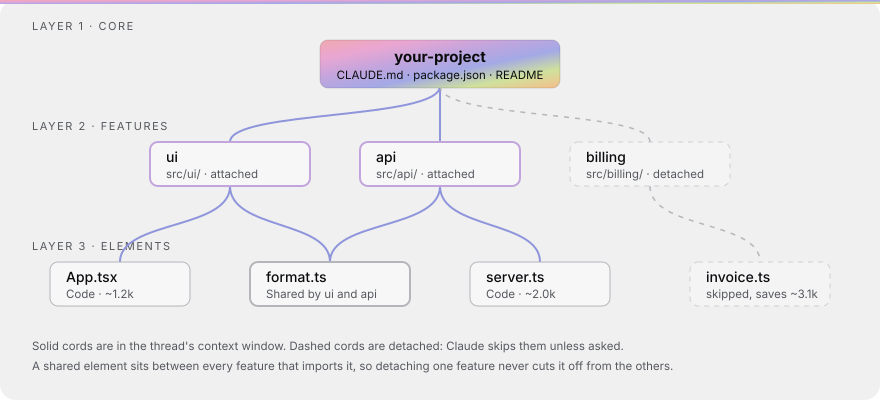

<p align="center"></p>

# WEAVE

**A live network map of your project's context.** WEAVE runs on your computer. It shows which files Claude can see, lets you choose what each thread loads, and lights up as Claude reads, edits, runs commands and opens PRs.

- **It maps your real files.** WEAVE scans the project and builds the map from what is actually there. Nothing is a placeholder.
- **It uses no tokens to build or run.** The scanner, the rules and the map are plain code. Claude is never asked to do the mapping.
- **It stays local.** The map server only listens on `127.0.0.1`. The single exception is optional exact token counting, which you have to turn on yourself (see [Token counts](#token-counts)).

---

## How the map works

The map has three layers:

```
your-project                     ← 1 · Core: CLAUDE.md, README, package.json. Every thread sees it.
├── src/ui        (attached)     ← 2 · Features: top-level folders, workspaces, or src/<name>
│   ├── App.tsx
│   └── format.ts ◄──┐           ← 3 · Elements: the files. A file imported by two features
├── src/api       (attached)  │       is shared and sits between them.
│   ├── server.ts             │
│   └── format.ts ────────────┘
└── src/billing   (detached)     ← Detached: Claude skips it unless you ask
    └── invoice.ts
```

- **Full project** is the default view: every file attached. Threads without a preset use it, and the map never detaches anything from it (sleeping overdue files is the one exception, and only when you click).
- **Presets** are saved context windows: the features a thread loads, minus any files you detached. **Save warm files as preset** makes one from the files that are warm right now and names it by fixed rules: mostly UI or design files becomes "UI", mostly docs "Docs", mostly tests "Tests", otherwise the main folder. While a preset is selected, an **Editing** label on the map reminds you that clicking cords changes it.
- **Threads** are your Claude Code sessions. Each one runs on a preset, and several threads can share one. In the **Context** panel on the right, every thread sits under its preset with an orb showing what it is doing; use its dropdown to move it to another preset.
- **Cords** connect the layers. Click a cord, or use Detach in the node panel, to take something out of the window. Click it again to bring it back.

### What you see live

| Claude does | On the map |
|---|---|
| Reads a file | A pulse flows **in** from the file to the core. Its size and label show the tokens it adds. |
| Edits a file | A pulse flows **out** from the core to the file. |
| Runs a command | A pulse goes out to the tool (`npm run test`, Shell, Git) and the output comes back. |
| Opens a PR | Every file the thread edited sends its change to the core, then one bundle goes to Git. |

While Claude works on a node, a tag on it expands in the preset's colour, with a small animated orb, the action and the elapsed seconds. The three most-used files give off embers. Zoom out and the cards collapse into labelled boxes, like a graph view.

### Suggestions are fixed rules, not AI

- **Asked while detached:** Claude read or edited a file that is detached from its thread's window.
- **Linked file:** a detached file tests, or is imported by, a file that was just edited.
- **Unused:** an attached file nobody touched in the last 10 actions. Only while warm and cold is off; with it on, such files are simply cold.
- **Overdue:** attached files with no read or edit in 14 days. **Put to sleep** (per file, or all at once) detaches them and leaves them out of the thread note. A sleeping file wakes, reattached, the moment Claude reads or edits it, whatever the other settings say. Nothing is ever put to sleep without your click.

Settings are in the gear menu in the top bar. **Reattach files Claude asks for** only ever reattaches; detaching always waits for you. The meter next to it is one bar for the whole project: warm, cold, overdue and detached, with the numbers on hover. Click the overdue count to highlight those files on the map.

**Warm and cold context** (on by default) ranks attached files by how much threads use them. A file's heat is its reads plus twice its edits, halved every three days. The hottest files (up to 12) are warm: a new thread's note lists them under "Warm, start here", and the map gives them a glow. Every other attached file is cold: still attached and never blocked, but the note tells Claude to open it only when the task needs it, and the map fades it back. The top three warm files with a heat of 10 or more are hot and give off embers. It is plain arithmetic over the activity log, with no model involved, so the same activity always gives the same result. Nothing is detached and presets are never edited, so a cold file that gets used simply warms up again. Until something has been used, the note stays as it was. When Claude asks for a detached file you choose between **Allow and flag** (the default: it works, and the map marks it) and **Block** (Claude Code is told the file is detached and should ask you).

---

## Install

Requires Node.js 18.17 or newer.

```bash
npm install -g github:xTycho/WEAVE      # gives you the `weave` command
cd /path/to/your-project
weave init                              # scan, write the map, register MCP and hooks
weave ui                                # open http://127.0.0.1:3000
```

`weave init` does five things in your project, and you can run it again at any time:

1. It adds a short WEAVE section to `CLAUDE.md`. It only appends, and it never overwrites your text.
2. It scans the project into `.claude/context-map.json`.
3. It registers the `weave` MCP server in `.mcp.json`, using absolute paths.
4. It adds activity hooks to `.claude/settings.local.json`, which is your local, uncommitted settings file. Skip this with `--no-hooks`.
5. It adds WEAVE's local state to `.gitignore`.

Restart Claude Code afterwards so it loads the tools and hooks.

## Claude Desktop (global config)

Claude Desktop reads its MCP servers from one global file:

| OS | Config file |
|---|---|
| macOS | `~/Library/Application Support/Claude/claude_desktop_config.json` |
| Windows | `%APPDATA%\Claude\claude_desktop_config.json` |
| Linux | `~/.config/Claude/claude_desktop_config.json` |

Let WEAVE write the entry for you. It uses absolute paths, so the location Desktop starts from does not matter:

```bash
cd /path/to/your-project
weave desktop            # print the entry
weave desktop --write    # merge it into the config file
```

The entry looks like this (your paths will differ):

```json
{
  "mcpServers": {
    "weave": {
      "command": "/usr/local/bin/node",
      "args": ["/usr/local/lib/node_modules/weave/bin/weave.js", "mcp", "--dir", "/Users/you/code/your-project"]
    }
  }
}
```

Restart Claude Desktop. The MCP server keeps a debounced watch on `.claude/context-map.json`. When you toggle something in the map, the server picks it up straight away and tells Desktop that the context changed, so you don't need to restart.

---

## Tutorial: automatic mapping and token efficiency

**1. Let the scanner do the first pass.** Run `weave init` and open the map. Root files become the core. Each top-level folder becomes a feature, and so does each sub-folder of `src/`, `lib/`, `packages/` or `apps/`. Files become elements. Imports, including tsconfig `paths` aliases and workspace packages, mark which files are shared between features. Tests are linked to the code they import. Package scripts become tool nodes. Big features fold their sub-folders into one node each, so the map stays readable.

**2. Make a preset per kind of task.** Work for a while, then click **Save warm files as preset**, or select a preset and click **Duplicate**. Then detach the features that task doesn't need by clicking their cords. The meter at the top shows how many tokens the window holds.

**3. Point each thread at a preset.** In the Context panel, use the dropdown next to each thread. When a new thread starts, Claude Code receives a short note naming its window: core files, attached folders, and detached files to skip. The note costs about 100 to 200 tokens however big the project is, because it lists folders, not file contents.

**4. Let Claude adjust the window.** Claude can call these MCP tools, and each one returns paths and ids, never file contents:

| Tool | What it does |
|---|---|
| `weave_get_context` | Lists the window: core files, attached folders, detached files |
| `weave_map` | Lists features and presets with their token cost |
| `weave_attach` / `weave_detach` | Adds or removes a feature or file (by id, path or label) |
| `weave_create_preset` | Saves a new window, optionally as the default for new threads |
| `weave_is_attached` | Checks whether one path is in the window |

**5. Start a feature from a design.** Select a design node (CSS, SVG or theme tokens) and click **New feature from this**. If you pick a saved preset under **Bring a saved preset**, everything in that preset joins the new feature, so its context comes along.

### Structuring a project for fewer tokens

- **Keep `CLAUDE.md` short.** It is in every thread. Put area-specific notes in that area's folder, so they load only when the feature is attached.
- **One concern per folder.** WEAVE makes features from folders, so a clear folder layout gives you clean presets.
- **Watch the shared nodes.** A file shared by many features is pulled into all of them. Splitting a big shared file often saves more than detaching a feature.
- **Detach generated and vendored code** you never want Claude to read.
- **Put overdue files to sleep.** They cost nothing in the note and wake by themselves when needed.

### Where the savings come from

The note WEAVE adds to a thread is small, about 100 to 200 tokens. The saving comes from Claude reading fewer files: it starts out knowing which folders matter and which to skip, so it searches and opens less. How much that saves depends on the project and the task.

---

## Token counts

By default every count is an **estimate**: the file's size divided by 4. It runs fully offline.

For **exact** counts, add an Anthropic API key, either in the map under Settings, **Exact token counts** or with `weave key set`, which hides what you type. You can also set `ANTHROPIC_API_KEY` in the environment. How the key is handled:

- It is stored in a private file in your user config folder: `~/.config/weave/` on Linux and macOS, `%APPDATA%\weave\` on Windows. The file is readable only by you. The key is never stored in the project, the map file or git.
- The map can save or remove the key, but it can never read it back. Claude never sees it.
- Counting sends each file's text, with the key, to Anthropic's free `count_tokens` endpoint. Nothing else is sent anywhere. Each file is counted once and counted again only when it changes.

Run `weave key remove` to go back to estimates.

## Commands

```
weave init [--no-hooks]     scan, write the map, register MCP and hooks
weave ui [--port 3000]      open the map (walks to the next port if 3000 is taken)
weave mcp                   MCP server over stdio (Claude Code and Claude Desktop)
weave desktop [--write]     Claude Desktop config with absolute paths
weave scan                  rescan now (the map also rescans when files change)
weave status [--preset id]  print the note a new thread receives
weave key set|remove        optional exact token counting
```

Every command takes `--dir <path>` to point at a project other than the current folder.

## Files WEAVE writes

| Path | What it holds | In git? |
|---|---|---|
| `.claude/context-map.json` | Scanned nodes, presets, thread assignments, settings | No |
| `.claude/weave/activity.jsonl` | What threads did (tool, file, time); rotates at 512 KB | No |
| `.claude/weave/threads.json` | Thread names and transcript paths | No |
| `.claude/weave/token-cache.json` | Exact counts per file, when a key is set | No |
| `.claude/settings.local.json` | The activity hooks | No |

## Project layout

```
bin/weave.js            CLI
src/scanner/            file listing, import parsing, the three-layer scan
src/engine/             context windows, rules, activity log, token counts
src/store.ts            reads and writes the map file (atomic, never throws on read)
src/server/             local HTTP + WebSocket server for the map
src/mcp/                MCP server and tools
src/hooks/              Claude Code hook handler
src/ui/                 the map (Vite); src/ui/dist is committed so it works without a build
```

The routing layer in `src/engine/window.ts` decides what is in a window from the map file alone. It never edits your project files, and it never edits `CLAUDE.md` after `init`.

## Development

```bash
npm install
npm run build      # server (tsc) and map (vite)
npm test
npm run dev:ui     # map with hot reload; run `weave ui` alongside it for the API
```

## License

MIT. Third-party notices are in [THIRD_PARTY_NOTICES.md](THIRD_PARTY_NOTICES.md).
